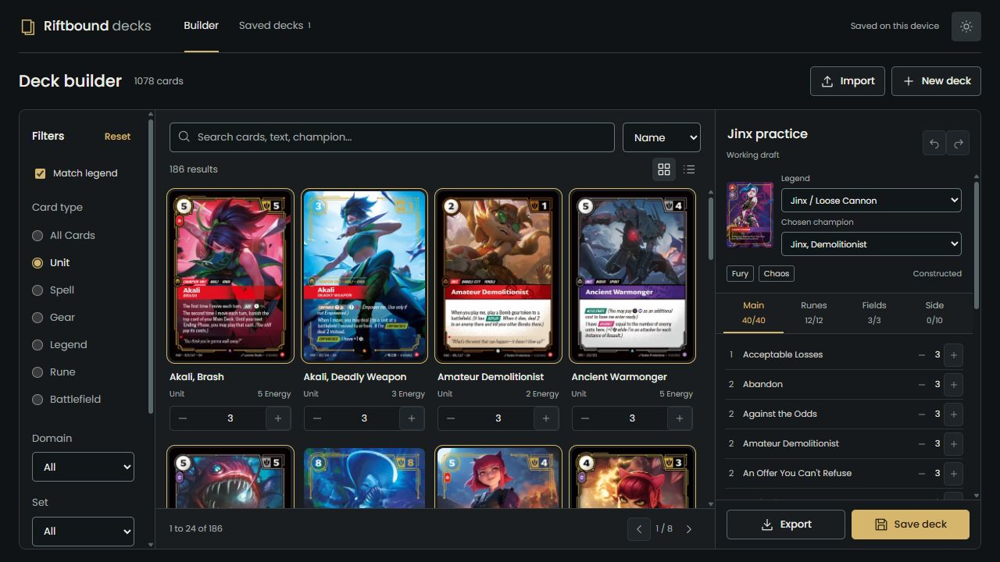

# Riftbound Deck Builder

An Angular 22 workbench for building Riftbound decks. Search the official card catalog, choose your legend and champion, and manage the main deck, runes, battlefields and sideboard.

[Open the app](https://jpndmatos.github.io/riftbound-deck-builder/)

Includes energy curves, Constructed checks, undo and redo, saved decks, text exports and JSON backups. Cards load as you scroll. Filters stay in the URL. Decks stay in your browser. The charcoal workspace fits the window on desktop, tablet and mobile, with scrolling inside each panel.

## Development

Use Node.js 22.22.3 or newer. Install with npm ci, then run npm start. Run npm test for the tests and npm run build for a production build.

## Angular

Standalone components, signal-based state, computed deck checks, reactive forms, lazy routes, typed HttpClient requests and OnPush change detection. Vitest covers imports, deck rules and state changes. GitHub Actions tests and builds before deploying.

## Card data

Data comes from the [official gallery](https://playriftbound.com/en-us/card-gallery/). Alternate printings are grouped, preserving full card names. Run npm run catalog:sync to refresh the snapshot. See the [official rules hub](https://playriftbound.com/en-us/rules-hub/) for updates.

Checks cover standard deck construction. Special card instructions still need review. The example list is a practice deck.

Riftbound art, names and game text belong to Riot Games. This is an independent fan project.
